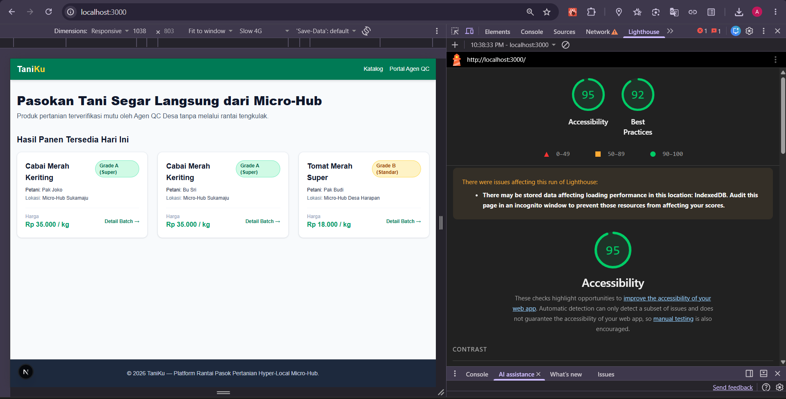
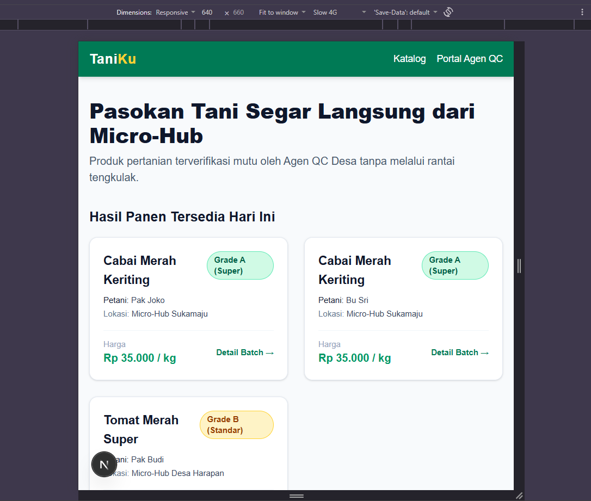
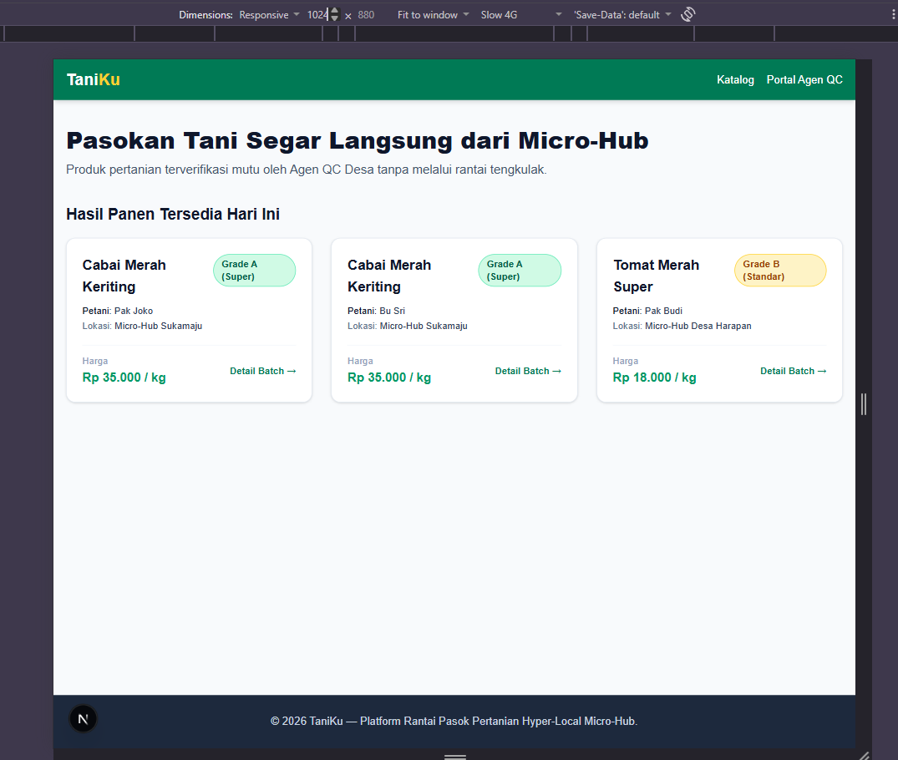
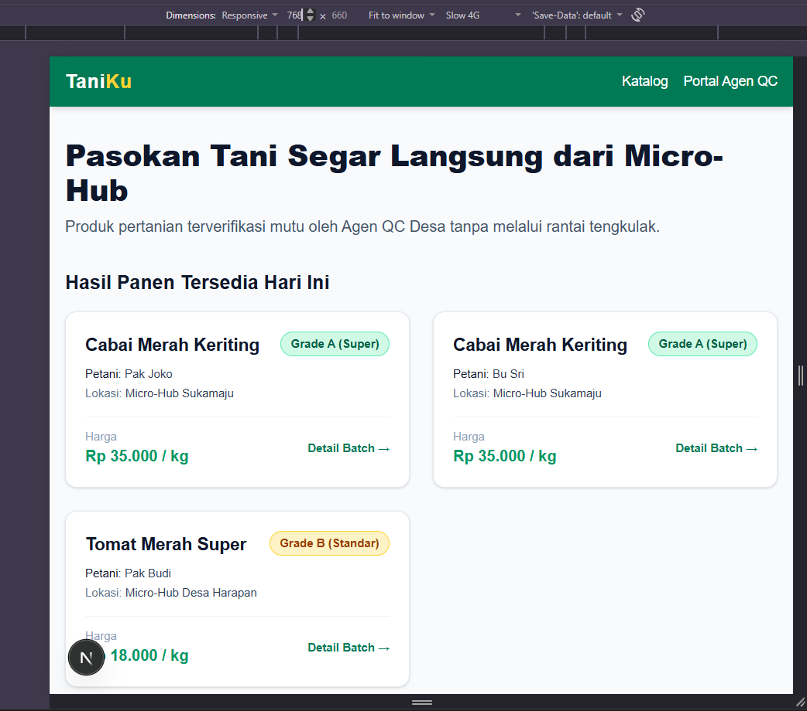

# TaniKu — Hyper-Local Micro-Hub Platform (v0.1)

TaniKu adalah platform aplikasi web rantai pasok pertanian terintegrasi yang dirancang untuk memotong rantai distribusi panjang dari petani ke konsumen secara langsung (_direct-to-consumer_ & _direct-to-business_). Melalui jaringan **Micro-Hub Desa** dan **Verifikasi Mutu Mutakhir (Quality Control)** berbasis kriptografi, TaniKu memastikan kepastian harga adil bagi petani serta transparansi kualitas bahan pangan segar bagi konsumen.

Proyek ini dikembangkan secara terintegrasi untuk memenuhi milestone perkuliahan **Pengembangan Aplikasi Web**, **Kriptografi**, dan **Keamanan Komputasi & Siber**.

---

## 🎯 Konsep & Permasalahan Produk

- **Permasalahan:** Rantai pasok pertanian tradisional yang terfragmentasi dan didominasi tengkulak menyebabkan margin keuntungan petani sangat kecil, risiko pemalsuan grade mutu panen, serta tingginya lonjakan harga di tingkat konsumen akhir.
- **Sasaran Pengguna:**
  1. **Petani & Agen QC Desa:** Mencatat, memverifikasi, dan melakukan digitalisasi grade hasil panen di titik kumpul (Micro-Hub).
  2. **Konsumen / Pembeli Bisnis (D2C/D2B):** Membeli komoditas pertanian segar yang terverifikasi mutu dan dapat dilacak asal-usulnya.

---

## 🌟 Fitur Utama Milestone 1

1. **Katalog Hasil Panen (Konsumen):** Tampilan etalase produk pertanian terverifikasi lengkap dengan informasi harga, grade mutu, lokasi Micro-Hub, dan ketersediaan stok ter-update (_localStorage simulation_).
2. **Portal Agen QC (Form Entry & Validasi Client-Side):** Formulir penginputan hasil panen petani dengan validasi _client-side_ ketat (nama petani, berat panen > 0 kg, komoditas, dan grade hasil uji).
3. **Detail & Lacak Batch Panen (`/batch/[id]`):** Tampilan detail pelacakan riwayat panen (peta/lokasi hub, nama petani, tanggal panen, dan status verifikasi).
4. **Verifikasi Integritas Data (Kriptografi Ed25519):** Modul penandatanganan digital (_digital signature_) data batch panen oleh Agen QC untuk menjamin _data integrity_ dan mematikan potensi _tampering_ mutu.

---

## 🛠️ Teknologi yang Digunakan

- **Framework Web:** Next.js 15+ (React 19, TypeScript, App Router)
- **Styling & UI:** Tailwind CSS & Lucide Icons
- **Pengujian Unit & Kriptografi:** Jest & `ts-jest` (Node.js `crypto` Ed25519)
- **Aksesibilitas & Kinerja:** Google Chrome Lighthouse

---

## 📸 Bukti Pengujian & Antarmuka Produk

### 1. Hasil Pengujian Aksesibilitas (Lighthouse)



- **Score Accessibility:** ≥ 85
- **Mode Pengujian:** Navigation
- **Perangkat Emulasi:** Desktop / Mobile (Moto G Power)
- **Versi Chrome:** Google Chrome Version 155.0.8059.40 (Official Build) (64-bit)

---

### 2. Pengujian Tampilan Responsif

#### Mobile View (Ponsel ≤ 640px)



#### Tablet View (768px)



#### Desktop View (≥ 1024px)



## 📁 Struktur Proyek

```text
tubestaniku/
├── docs/                     # Laporan & Bukti Pengujian
│   ├── lighthouse/
│   │   └── lighthousescore.png
│   └── responsiveTest/
│       ├── 640.png          # Tampilan Mobile (≤ 640px)
│       ├── 768.png          # Tampilan Tablet (768px)
│       └── 1024.png         # Tampilan Desktop (≥ 1024px)
├── src/
│   ├── app/                  # Next.js App Router (Layout & Pages)
│   │   ├── page.tsx          # Beranda / Katalog Konsumen
│   │   ├── layout.tsx        # Root Layout & Metadata
│   │   ├── globals.css       # Tailwind CSS Directives
│   │   ├── qc/page.tsx       # Portal Agen QC (Form Drop-Off)
│   │   └── batch/[id]/       # Dynamic Route Detail & Trace Batch
│   ├── components/           # Reusable UI Components
│   │   ├── BadgeGrade.tsx
│   │   ├── Button.tsx
│   │   ├── Footer.tsx
│   │   ├── Navbar.tsx
│   │   └── ProductCard.tsx
│   ├── data/
│   │   └── mockBatches.ts    # Mock Data Hasil Panen
│   └── batchSigner.ts        # Modul Kriptografi Ed25519
├── test/
│   └── batchSigner.test.ts   # Pengujian Otomatis Jest (4 Skenario)
├── jest.config.js            # Konfigurasi ts-jest
├── tsconfig.json             # Konfigurasi TypeScript
└── README.md


```
