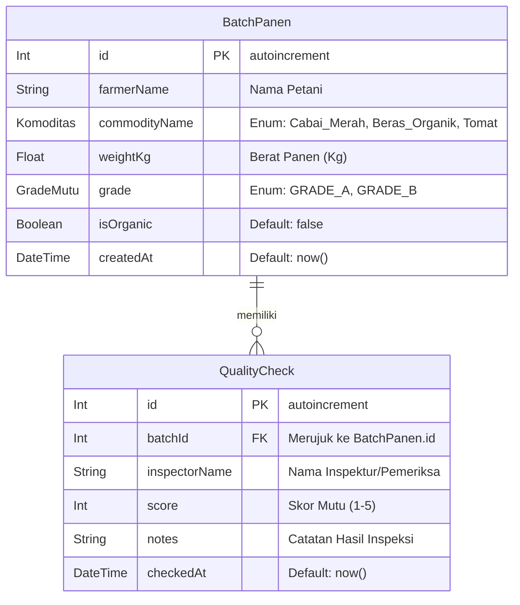

# Dokumen Teknis Modul 6: PostgreSQL dan Prisma ORM

**Nama / NIM** : Adrenalin Syahrobby / 105224030  
**Nama Produk** : TubesTaniKu  
**Repositori** : `https://github.com/username/tubestaniku`  
**Branch** : `praktikum/modul-06`

---

## 1. Rancangan Data

### Diagram Entitas dan Relasi (1:N)

Aplikasi **TubesTaniKu** mengelola data entitas utama **`BatchPanen`** (parent) dan entitas anak **`QualityCheck`** (child) yang terhubung dalam relasi 1:N (satu batch panen dapat memiliki banyak catatan inspeksi mutu).



### Constraint Unik

1. **`BatchPanen`**: `@@unique([farmerName, commodityName])`  
   Mencegah petani mendaftarkan komoditas yang sama lebih dari satu kali dalam basis data.
2. **`QualityCheck`**: `@@unique([batchId, inspectorName])`  
   Mencegah inspektur yang sama memberikan ulasan/catatan mutu ganda untuk satu batch panen yang sama.

### Alasan Pemilihan Aturan `onDelete: Restrict`

Aturan penghapusan `onDelete: Restrict` dipilih secara sengaja demi menjaga **integritas audit mutu produk pertanian**. Data inspeksi mutu (`QualityCheck`) merupakan rekam jejak legalitas dan transparansi kualitas panen yang sangat krusial dalam rantai pasok pascapanen. Jika entitas parent (`BatchPanen`) dihapus secara langsung, basis data akan **menolak** operasi tersebut kecuali seluruh data inspeksi anak dihapus terlebih dahulu secara sadar dan atomik melalui transaksi aplikasi (`prisma.$transaction`). Hal ini mencegah terhapusnya data inspeksi secara tidak sengaja (_accidental cascading deletion_).

---

## 2. Skema dan Migrasi

### Berkas `prisma/schema.prisma`

```prisma
generator client {
  provider = "prisma-client"
  output   = "../generated/prisma"
}

datasource db {
  provider = "postgresql"
}

enum Komoditas {
  Cabai_Merah   @map("Cabai Merah")
  Beras_Organik @map("Beras Organik")
  Tomat
}

enum GradeMutu {
  GRADE_A
  GRADE_B
}

model BatchPanen {
  id            Int            @id @default(autoincrement())
  farmerName    String
  commodityName Komoditas
  weightKg      Float
  grade         GradeMutu
  isOrganic     Boolean        @default(false)
  createdAt     DateTime       @default(now())
  qualityChecks QualityCheck[]

  @@unique([farmerName, commodityName])
}

model QualityCheck {
  id            Int        @id @default(autoincrement())
  batchId       Int
  inspectorName String
  score         Int
  notes         String
  checkedAt     DateTime   @default(now())
  batch         BatchPanen @relation(fields: [batchId], references: [id], onDelete: Restrict)

  @@unique([batchId, inspectorName])
}
```

### Daftar Folder Migrasi & Potongan SQL (`prisma/migrations/20261106041348_init/migration.sql`)

```sql
-- CreateEnum
CREATE TYPE "Komoditas" AS ENUM ('Cabai Merah', 'Beras Organik', 'Tomat');
CREATE TYPE "GradeMutu" AS ENUM ('GRADE_A', 'GRADE_B');

-- CreateTable
CREATE TABLE "BatchPanen" (
    "id" SERIAL NOT NULL,
    "farmerName" TEXT NOT NULL,
    "commodityName" "Komoditas" NOT NULL,
    "weightKg" DOUBLE PRECISION NOT NULL,
    "grade" "GradeMutu" NOT NULL,
    "isOrganic" BOOLEAN NOT NULL DEFAULT false,
    "createdAt" TIMESTAMP(3) NOT NULL DEFAULT CURRENT_TIMESTAMP,

    CONSTRAINT "BatchPanen_pkey" PRIMARY KEY ("id")
);

-- CreateTable
CREATE TABLE "QualityCheck" (
    "id" SERIAL NOT NULL,
    "batchId" INTEGER NOT NULL,
    "inspectorName" TEXT NOT NULL,
    "score" INTEGER NOT NULL,
    "notes" TEXT NOT NULL,
    "checkedAt" TIMESTAMP(3) NOT NULL DEFAULT CURRENT_TIMESTAMP,

    CONSTRAINT "QualityCheck_pkey" PRIMARY KEY ("id")
);

-- CreateIndex
CREATE UNIQUE INDEX "BatchPanen_farmerName_commodityName_key" ON "BatchPanen"("farmerName", "commodityName");

-- CreateIndex
CREATE UNIQUE INDEX "QualityCheck_batchId_inspectorName_key" ON "QualityCheck"("batchId", "inspectorName");

-- AddForeignKey
ALTER TABLE "QualityCheck" ADD CONSTRAINT "QualityCheck_batchId_fkey"
FOREIGN KEY ("batchId") REFERENCES "BatchPanen"("id")
ON DELETE RESTRICT ON UPDATE CASCADE;
```

### Hasil Pemeriksaan Struktur Tabel PostgreSQL (`\d "QualityCheck"`)

```text
                                           Table "public.QualityCheck"
    Column     |           Type           | Collation | Nullable |                 Default
---------------+--------------------------+-----------+----------+------------------------------------------
 id            | integer                  |           | not null | nextval('"QualityCheck_id_seq"'::regclass)
 batchId       | integer                  |           | not null |
 inspectorName | text                     |           | not null |
 score         | integer                  |           | not null |
 notes         | text                     |           | not null |
 checkedAt     | timestamp(3) without time|           | not null | CURRENT_TIMESTAMP
Indexes:
    "QualityCheck_pkey" PRIMARY KEY, btree (id)
    "QualityCheck_batchId_inspectorName_key" UNIQUE Constraint, btree ("batchId", "inspectorName")
Foreign-key constraints:
    "QualityCheck_batchId_fkey" FOREIGN KEY ("batchId") REFERENCES "BatchPanen"(id) ON DELETE RESTRICT ON UPDATE CASCADE
```

---

## 3. Seed dan Prisma Client

### Output Eksekusi Seed Berulang (`npx prisma db seed`)

**Eksekusi Pertama:**

```bash
$ npx prisma db seed
Running seed command `tsx prisma/seed.ts` ...
Seed Modul 6 Berhasil! Batch panen & catatan QualityCheck telah disuntikkan.
✔ Finished seeding.
```

**Eksekusi Kedua (Membuktikan Idempotensi via `upsert`):**

```bash
$ npx prisma db seed
Running seed command `tsx prisma/seed.ts` ...
Seed Modul 6 Berhasil! Batch panen & catatan QualityCheck telah disuntikkan.
✔ Finished seeding.
```

_Catatan: Jumlah entitas di database tetap sama karena pencocokan `where` unik pada metode `upsert` mencegah terjadinya duplikasi data._

### Mengapa Skrip Seed Tidak Mengimpor `lib/prisma.ts`?

Skrip `prisma/seed.ts` dijalankan di luar siklus hidup (_runtime_) aplikasi Next.js menggunakan _tooling_ `tsx` secara langsung melalui CLI. Sementara itu, berkas `src/lib/prisma.ts` mencantumkan direktif `"server-only"`. Apabila skrip seed mengimpor `lib/prisma.ts`, eksekusi seed akan langsung digagalkan oleh modul bundler karena direktif `"server-only"` melarang pengimporan berkas tersebut di luar runtime Next.js server context. Oleh sebab itu, `seed.ts` menginstansiasi `PrismaClient` tersendiri.

---

## 4. Operasi CRUD

### Pemetaan Operasi Prisma Client

| Entitas          | Operasi     | Lokasi (Aksi/Halaman)               | Metode Prisma                               | Galat Prisma Ditangani      | Pesan ke Pengguna                                                              |
| :--------------- | :---------- | :---------------------------------- | :------------------------------------------ | :-------------------------- | :----------------------------------------------------------------------------- |
| **BatchPanen**   | Create      | `src/app/batch/actions.ts`          | `prisma.batchPanen.create()`                | `P2002` (Unique Constraint) | _"Petani sudah mendaftarkan komoditas ini."_                                   |
| **BatchPanen**   | Read List   | `src/lib/data.ts`                   | `prisma.batchPanen.findMany()`              | `null`                      | Halaman katalog menampilkan daftar kosong / loading                            |
| **BatchPanen**   | Read Detail | `src/lib/data.ts`                   | `prisma.batchPanen.findUnique()`            | `null`                      | Redireksi ke halaman 404 via `notFound()`                                      |
| **BatchPanen**   | Delete      | `src/app/batch/actions.ts`          | `prisma.$transaction([deleteMany, delete])` | `P2025` (Record not found)  | _"Batch panen tidak ditemukan atau sudah dihapus."_                            |
| **QualityCheck** | Create      | `src/app/katalog/ulasan-actions.ts` | `prisma.qualityCheck.create()`              | `P2002`, `P2003`            | _"Pemeriksa ini sudah mengulas batch ini."_ / _"Batch panen tidak ditemukan."_ |
| **QualityCheck** | Delete      | `src/app/katalog/ulasan-actions.ts` | `prisma.qualityCheck.deleteMany()`          | `P2025`                     | Revalidasi tampilan halaman detail                                             |

---

## 5. Transaksi dan Rollback

### Galat Penghapusan Tanpa Transaksi (`ON DELETE RESTRICT`)

Ketika mencoba menghapus entitas `BatchPanen` yang memiliki relasi `QualityCheck` secara langsung menggunakan `prisma.batchPanen.delete({ where: { id } })`, basis data PostgreSQL menolak operasi tersebut karena adanya constraint foreign key `ON DELETE RESTRICT`.

**Pesan Galat Terminal:**

```text
PrismaClientKnownRequestError:
Invalid `prisma.batchPanen.delete()` invocation:
Foreign key constraint failed on the field: `QualityCheck_batchId_fkey (index)`
  code: 'P2003',
  clientVersion: '7.x'
```

### Bukti Pengujian Rollback Atomik

Untuk membuktikan bahwa `prisma.$transaction` bekerja secara atomik, dilakukan pengujian dengan sengaja menyisipkan perintah kedua yang bernilai salah/gagal (`id` bernilai `999999`):

```typescript
// Pengujian Rollback (Sengaja dibuat gagal pada perintah 2)
await prisma.$transaction([
  prisma.qualityCheck.deleteMany({ where: { batchId: id } }), // Berhasil
  prisma.batchPanen.delete({ where: { id: 999999 } }), // Gagal (P2025)
]);
```

**Hasil Pemeriksaan Database via `psql` Sebelum dan Sesudah Pengujian Rollback:**

```sql
tubestaniku=# SELECT "batchId", COUNT(*) FROM "QualityCheck" GROUP BY "batchId";
 batchId | count
---------+-------
       1 |     1
```

_Hasil menunjukkan bahwa meskipun `deleteMany` pada baris pertama sempat dieksekusi, kegagalan pada perintah kedua memicu pembatalan menyeluruh (**rollback**), sehingga catatan `QualityCheck` tetap utuh dan tidak ada data yang hilang parsial._

---

## 6. Skenario Uji

| No  | Nama Skenario             | Langkah Pengujian                                   | Hasil Diharapkan                                       | Hasil Aktual                                                           |  Status   |
| :-: | :------------------------ | :-------------------------------------------------- | :----------------------------------------------------- | :--------------------------------------------------------------------- | :-------: |
|  1  | Tambah Batch Sah          | Mengisi formulir batch panen baru dengan data valid | Data tersimpan di DB, redirect ke katalog              | Data tersimpan di PostgreSQL, halaman katalog terbarui                 | **Lulus** |
|  2  | Tambah Batch Duplikat     | Mengisi nama petani & komoditas yang sama persis    | Ditolak oleh constraint `P2002`, pesan galat tampil    | Pesan galat _"Petani sudah mendaftarkan komoditas ini"_ muncul di form | **Lulus** |
|  3  | Input Form Tidak Sah      | Mengisi berat panen negatif atau string kosong      | Ditolak oleh validasi Zod di Server Action             | Pesan galat spesifik per kolom ditampilkan dari Zod                    | **Lulus** |
|  4  | Read Detail Batch Valid   | Membuka rute `/batch/1`                             | Halaman detail menampilkan informasi batch & ulasan QC | Tampil detail batch panen beserta riwayat inspeksi mutu                | **Lulus** |
|  5  | Read Detail Batch 99999   | Membuka rute `/batch/99999`                         | Menampilkan halaman 404 Not Found                      | Fungsi `notFound()` dipicu, halaman 404 ditampilkan                    | **Lulus** |
|  6  | Tambah QC Sah             | Mengisi form inspeksi mutu pada detail batch        | Data `QualityCheck` tersimpan & terhubung ke batch     | Catatan QC baru langsung muncul di daftar riwayat                      | **Lulus** |
|  7  | Tambah QC Duplikat        | Inspektur yang sama mengulas batch yang sama        | Ditolak `P2002`, pesan galat tampil                    | Pesan galat _"Pemeriksa ini sudah mengulas batch ini"_ tampil          | **Lulus** |
|  8  | Hapus QC                  | Menekan tombol "Hapus Inspeksi" pada item ulasan    | Record `QualityCheck` terhapus dari basis data         | Ulasan hilang dari layar & terhapus dari tabel DB                      | **Lulus** |
|  9  | Hapus Batch Transaksional | Menekan "Hapus Batch Panen" pada batch berulasan    | Transaksi menghapus QC terlebih dahulu lalu Batch      | `BatchPanen` dan seluruh `QualityCheck` terkait terhapus               | **Lulus** |
| 10  | Pengujian Rollback        | Menjalankan transaksi dengan query kedua yang gagal | Seluruh operasi dibatalkan, data QC tidak berubah      | Data `QualityCheck` di DB tidak berkurang (Rollback berhasil)          | **Lulus** |

**Tingkat Kelulusan Skenario Uji**: 100% (10 dari 10 skenario lulus).

---

## 7. Kendala dan Penyelesaian

1. **Galat Autentikasi PostgreSQL (`P1000`)**
   - **Penyebab**: Koneksi ke PostgreSQL lokal gagal karena perbedaan kata sandi user default `postgres` dan belum dikonfigurasikannya user `praktikum`.
   - **Penyelesaian**: Menggunakan SQL Shell (`psql`) untuk membuat peran `praktikum` dengan kata sandi `lokal-saja-123` dan memberikan akses penuh pada database `tubestaniku`.

2. **Resolusi Path Import Prisma 7 (`ts(2307)`)**
   - **Penyebab**: Konfigurasi `output = "../generated/prisma"` pada Prisma 7 meletakkan Prisma Client di luar folder `src`, sehingga alias `@/generated` tidak terdeteksi oleh TypeScript.
   - **Penyelesaian**: Mengubah impor di `lib/prisma.ts` dan Server Actions menggunakan _relative pathing_ (seperti `../../generated/prisma/client` dan `../../../generated/prisma/client`).

3. **Ketidakcocokan Tipe Enum String vs TypeScript Enum (`ts(2322)`)**
   - **Penyebab**: Nilai komoditas dari masukan formulir ber-spasi (`"Cabai Merah"`), sedangkan enum TypeScript di Prisma Client memerlukan pengenal identifier (`Cabai_Merah`).
   - **Penyelesaian**: Menambahkan transformasi string `.replace(/ /g, "_")` sebelum mengirimkan payload data ke metode `prisma.batchPanen.create()`.

---

## 8. Catatan Pemanfaatan AI

- **Alat AI yang Digunakan**: Gemini 3 Flash / Antigravity AI
- **Perintah Utama / Prompt**:
  - _"Bantu mengonfigurasi Prisma 7 dengan adapter `@prisma/adapter-pg` dan menyusun skema dua entitas `BatchPanen` dan `QualityCheck`."_
  - _"Bagaimana penanganan error `P2002` dan pembentukan transaksi atomik pada Server Action Next.js App Router?"_
- **Bagian yang Dihasilkan AI**: Draft skema `schema.prisma`, struktur dasar `seed.ts` dengan `upsert`, serta kerangka dokumen teknis `modul-06.md`.
- **Metode Verifikasi & Validasi**:
  - Menjalankan `npx tsc --noEmit` untuk mengonfirmasi keamanan tipe data TypeScript.
  - Menjalankan `npx prisma db seed` dua kali untuk memverifikasi sifat idempoten.
  - Memeriksa langsung integritas indeks dan foreign key menggunakan perintah `\d "QualityCheck"` di terminal PostgreSQL.
