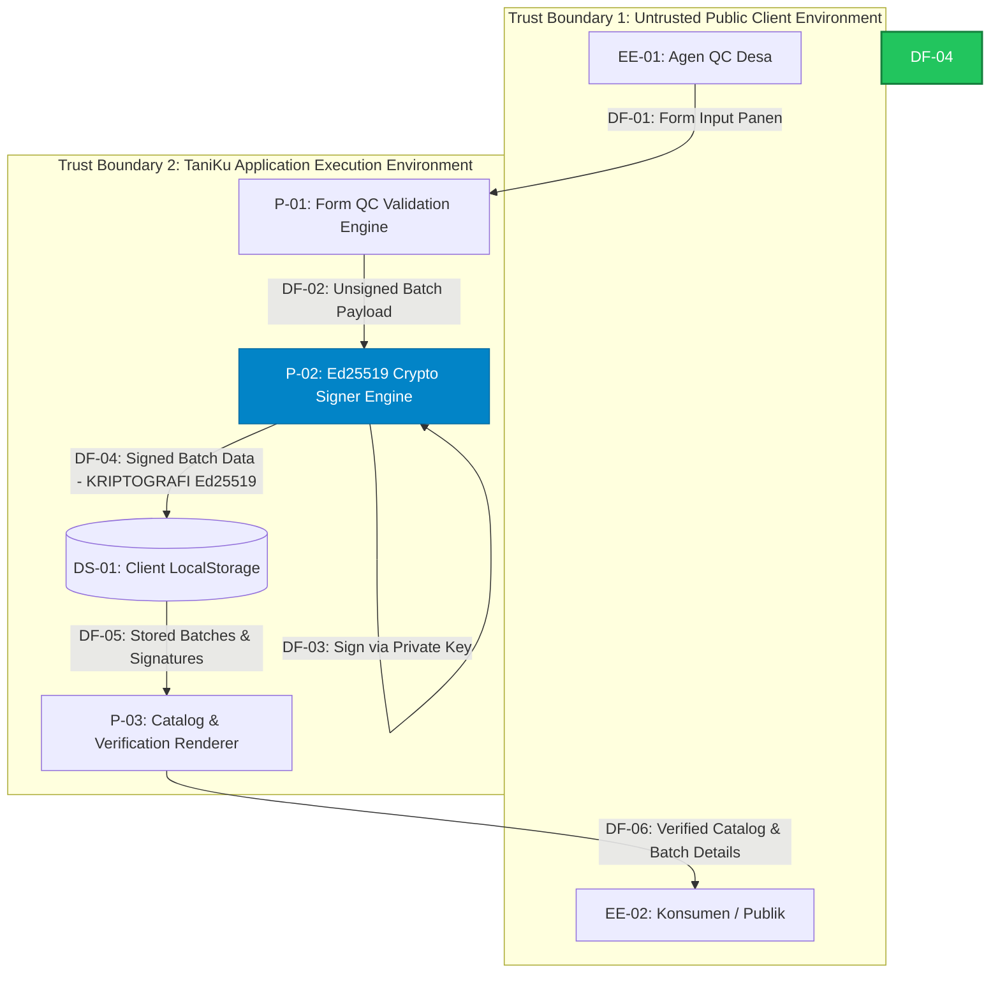

# Data Flow Diagram (DFD) — TaniKu Platform

Dokumen ini menjelaskan batas kepercayaan (_trust boundary_) dan aliran data pada arsitektur TaniKu v0.1.

## 1. Daftar Elemen DFD

- **External Entities (Aktor):**
  - `EE-01`: Agen QC Desa (User yang menguji & menginput panen)
  - `EE-02`: Konsumen / Pembeli Public (User yang melihat katalog & melacak batch)
- **Processes (Proses):**
  - `P-01`: Client-Side Validation & Batch Structuring (`/qc/page.tsx`)
  - `P-02`: Ed25519 Cryptographic Signer Engine (`src/batchSigner.ts`)
  - `P-03`: Catalog Rendering & Verification (`src/app/page.tsx` & `/batch/[id]`)
- **Data Stores (Penyimpanan Data):**
  - `DS-01`: Browser `localStorage` (`taniku_batches`)
- **Data Flows (Aliran Data):**
  - `DF-01`: Form Input Panen (Nama Petani, Berat, Grade)
  - `DF-02`: Unsigned Batch Payload
  - `DF-03`: Private Key & Payload untuk Penandatanganan
  - `DF-04`: **Signed Batch Data (Dilindungi Kriptografi Ed25519)**
  - `DF-05`: Batch Data & Signature dipersistensikan
  - `DF-06`: Pembacaan Katalog & Status Verifikasi Panen

---

## 2. Diagram DFD (Mermaid Syntax)

